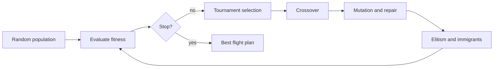

# UAV Strategy Engine
 
A Genetic Algorithm that evolves flight paths, speeds and sensor schedules for a fleet of 3 UAVs surveying a hazard grid.
 
  
 
[Quick start](#quick-start) | [Problem setup](#problem-setup) | [Results](#results) | [Method](#method) | [Sensitivity](#sensitivity-analysis) | [Structure](#project-structure)
 
## Quick start
 
```bash
git clone https://github.com/YOUR-USERNAME/uav-ga-strategy-engine.git
cd uav-ga-strategy-engine
pip install -r requirements.txt
python main.py
```
 
Runs in about 3 minutes and writes all figures to `results/`.
 
## Problem setup
 
| Item | Value |
|---|---|
| Grid | 50 x 50 cells |
| UAVs | 3, launched from base (2, 2) |
| Waypoints per UAV | 8 |
| Priority zones | 3 (weights 3.0, 2.5, 2.0; background 0.2) |
| Hazard pockets | 4 (intensity 0 to 1) |
| No-fly zones | 2 rectangles |
| Detection targets | 12 |
| Range limit | 100 cells per UAV |
 
## Results
 
Generation 0 (random routes) compared with generation 100 (evolved routes). Blue is covered area, orange and red are priority and hazard, hatched blocks are no-fly zones, stars are targets.
 
| Generation 0 | Generation 100 |
|:---:|:---:|
|  |  |
 
### GA vs random search (equal budget of 5,860 evaluations)
 
GA: 4 seeds (1, 2, 3, 42). Random search: 3 seeds (1, 2, 42). Std is the population standard deviation.
 
| Metric | GA mean ± std | GA range | Random search mean ± std | Random search range |
|---|:---:|:---:|:---:|:---:|
| Fitness | **0.251 ± 0.046** | 0.172 – 0.284 | -3.361 ± 0.305 | -3.701 – -2.962 |
| Priority coverage | **74.3% ± 3.7** | 70.0 – 78.4 | 37.1% ± 2.8 | 33.5 – 40.3 |
| Target detection | **93.8% ± 10.8** | 75.0 – 100.0 | 33.3% ± 0.0 | 33.3 – 33.3 |
| Energy (normalised) | **0.806 ± 0.039** | 0.754 – 0.857 | 1.711 ± 0.082 | 1.622 – 1.819 |
| Mission time (normalised) | **0.747 ± 0.086** | 0.674 – 0.888 | 1.449 ± 0.188 | 1.260 – 1.706 |
| Hazard exposure (normalised) | **0.318 ± 0.084** | 0.232 – 0.453 | 0.555 ± 0.023 | 0.533 – 0.586 |
| Constraint penalty | **0.000 ± 0.000** | 0.000 – 0.000 | 3.089 ± 0.300 | 2.695 – 3.423 |
 
Per-seed GA results:
 
| Seed | Fitness | Coverage | Detection | Energy | Time | Hazard | Penalty | Gens to 95% |
|:---:|:---:|:---:|:---:|:---:|:---:|:---:|:---:|:---:|
| 1 | 0.172 | 70.0% | 75% | 0.827 | 0.682 | 0.453 | 0.0 | 16 |
| 2 | 0.281 | 78.4% | 100% | 0.857 | 0.674 | 0.316 | 0.0 | 26 |
| 3 | 0.266 | 71.2% | 100% | 0.786 | 0.743 | 0.270 | 0.0 | 18 |
| 42 | 0.284 | 77.5% | 100% | 0.754 | 0.888 | 0.232 | 0.0 | 24 |
 
Per-seed random search results:
 
| Run | Seed | Fitness | Coverage | Detection | Energy | Time | Hazard | Penalty |
|---|:---:|:---:|:---:|:---:|:---:|:---:|:---:|:---:|
| Random search | 1 | -3.418 | 40.3% | 33% | 1.622 | 1.706 | 0.533 | 3.15 |
| Random search | 2 | -3.701 | 37.4% | 33% | 1.819 | 1.382 | 0.545 | 3.42 |
| Random search | 42 | -2.962 | 33.5% | 33% | 1.692 | 1.260 | 0.586 | 2.69 |
 
### Convergence
 
Best fitness by generation, per seed:
 
| Seed | Gen 0 | Gen 10 | Gen 25 | Gen 50 | Gen 75 | Gen 100 |
|:---:|:---:|:---:|:---:|:---:|:---:|:---:|
| 1 | -4.807 | -0.128 | -0.066 | 0.093 | 0.148 | 0.172 |
| 2 | -4.934 | -0.148 | 0.012 | 0.184 | 0.258 | 0.281 |
| 3 | -4.954 | -0.079 | 0.040 | 0.130 | 0.209 | 0.266 |
| 42 | -4.897 | -0.131 | 0.029 | 0.218 | 0.259 | 0.284 |
| **Mean** | **-4.898** | **-0.122** | **0.004** | **0.156** | **0.219** | **0.251** |
 
Speed of convergence:
 
| Milestone | Generations (per seed) | Mean |
|---|:---:|:---:|
| 90% of total improvement | 6, 6, 6, 6 | 6.0 |
| 95% of total improvement | 16, 26, 18, 24 | 21.0 |
| 99% of total improvement | 62, 68, 81, 59 | 67.5 |
 
Population statistics (mean of 4 seeds):
 
| Population statistic | Generation 0 | Generation 100 |
|---|:---:|:---:|
| Average fitness | -8.15 | -0.08 |
| Best fitness | -4.90 | 0.25 |
| Diversity (std of waypoint coords, cells) | 14.1 | 3.4 |
 
<details>
<summary>Show convergence plot</summary>
<br>

</details>
<details>
<summary>Show paths at all four snapshot generations</summary>
<br>

</details>
### Per-UAV breakdown (best solution, seed 42)
 
| UAV | Path length (cells) | Flight time | Sensor ON legs (of 8) | Mean speed | Mean sensor power |
|:---:|:---:|:---:|:---:|:---:|:---:|
| 1 | 66.3 | 61.9 | 5 | 1.09 | 0.48 |
| 2 | 65.1 | 66.4 | 5 | 1.06 | 0.59 |
| 3 | 95.7 | 88.8 | 4 | 1.13 | 0.65 |
 
## Method
 

 
### Chromosome
 
3 UAVs x 8 waypoints x 5 genes = 120 genes.
 
| Gene | Type | Range | Meaning |
|---|---|---|---|
| x, y | real | 0 to 49 | waypoint position |
| speed | real | 0.5 to 2.0 | speed multiplier on the leg |
| sensor power | real | 0 to 1 | sets the sensing radius |
| sensor on/off | binary | 0 or 1 | sensor schedule for the leg |
 
### Fitness function
 
```
F = 0.35*Coverage + 0.25*Detection - 0.15*Energy - 0.10*Time - 0.15*Hazard - Penalty
```
 
| Term | Weight | Direction | Description |
|---|:---:|:---:|---|
| Coverage | 0.35 | maximise | priority-weighted fraction of cells sensed |
| Detection | 0.25 | maximise | fraction of targets detected |
| Energy | 0.15 | minimise | flight energy plus sensor energy |
| Time | 0.10 | minimise | slowest UAV's flight time |
| Hazard | 0.15 | minimise | hazard integrated along the path |
| Penalty | n/a | minimise | no-fly crossings and range violations |
 
### Genetic operators and settings
 
| Component | Choice |
|---|---|
| Selection | tournament (size 3) with elitism (2 individuals) |
| Crossover (rate 0.85) | per-route segment swap or geometric blend |
| Mutation (rate 0.1) | Gaussian shift, random reset, bit flip, waypoint swap |
| Step size | decays from 6 to about 1 cell |
| Diversity | 10% random immigrants after stagnation |
| Constraints | repair (clip, push out of no-fly) plus penalty |
| Population / generations | 60 / 100 |
| Termination | max generations or no improvement for 40 generations |
 
## Sensitivity analysis
 
One parameter varied at a time around population 30, mutation rate 0.1 and tournament size 3. Each setting ran 30 generations with 2 seeds, so treat the differences as tendencies.
 
| Parameter | Value | Mean best fitness | Std | Evaluations |
|---|:---:|:---:|:---:|:---:|
| Population size | 15 | -0.043 | 0.001 | 405 |
| Population size | 30 | 0.014 | 0.017 | 870 |
| Population size | 60 | 0.057 | 0.015 | 1800 |
| Mutation rate | 0.02 | 0.056 | 0.018 | 870 |
| Mutation rate | 0.1 | 0.014 | 0.017 | 870 |
| Mutation rate | 0.3 | -0.107 | 0.011 | 870 |
| Tournament size | 2 | -0.028 | 0.071 | 870 |
| Tournament size | 4 | 0.099 | 0.055 | 870 |
| Tournament size | 8 | 0.024 | 0.030 | 870 |
 
Observations:
 
| Parameter | Finding |
|---|---|
| Population size | larger gave better fitness, but evaluations grow in proportion |
| Mutation rate | 0.3 clearly hurt; low rates did best in short runs |
| Tournament size | 4 gave the best mean; 2 was noisy and 8 over-exploited |
 
<details>
<summary>Show sensitivity plot</summary>
<br>

</details>
## Project structure
 
```
main.py               run the main simulation
run_experiments.py    sensitivity study (run in parts: pop, mut, sel, rs, plot)
run_stats.py          detailed statistics for one run (ga|rs SEED)
make_dark_plots.py    black-background plots
uav_ga/
  environment.py      grid, zones, hazards, targets
  chromosome.py       encoding and repair
  fitness.py          multi-objective fitness
  operators.py        selection, crossover, mutation
  ga.py               GA engine
  baseline.py         random-search baseline
  visualize.py        plots
results/              figures and JSON statistics
```
 
## Troubleshooting
 
| Error | Fix |
|---|---|
| `No module named matplotlib` | run `pip install -r requirements.txt` from the project folder |
| `No space left on device` | free disk space on the system drive, then rerun |

 
